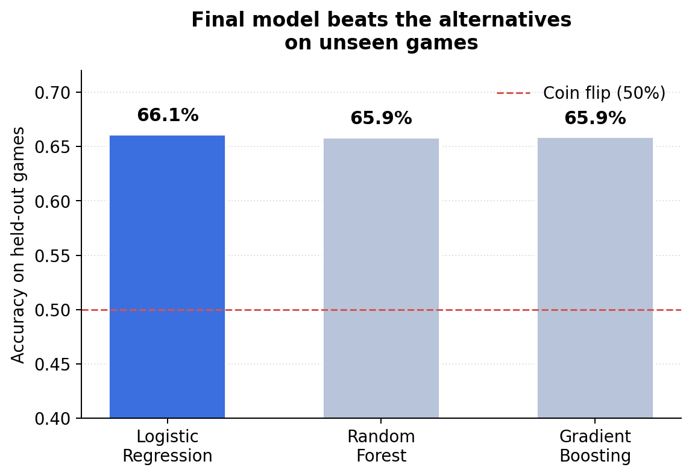
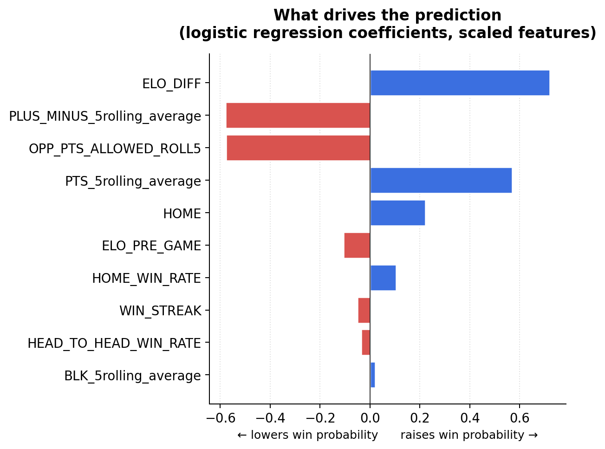

# Oddly: NBA Win Probability Predictor

Oddly predicts the probability that an NBA team wins a game using only box-score history. It pulls six seasons of team game logs, engineers features that capture team strength and situation (ELO ratings, rest, momentum, home court), and trains models that are validated **chronologically** so the results are not inflated by looking into the future.

**Final model:** Logistic Regression on 20 engineered features.
**Result:** **64.2%** mean accuracy across 5 time-based cross-validation folds (**66.1%** on the most recent held-out 20% of games).

## Results

| Model | Holdout accuracy | Holdout log loss | 5-fold CV accuracy |
|---|---|---|---|
| Logistic Regression (final) | **66.1%** | **0.615** | **64.2%** |
| Random Forest | 65.9% | 0.626 | 63.6% |
| Gradient Boosting | 65.9% | 0.620 | n/a |

Holdout = the most recent 20% of games (2,826 games), never seen in training. Coin-flip baseline is 50%.

Logistic Regression beat Random Forest on all 5 CV folds (63.3 / 63.8 / 61.8 / 65.3 / 66.8 vs 62.7 / 63.7 / 61.0 / 64.5 / 65.9).




### How the accuracy improved

| Step | Change | Holdout accuracy |
|---|---|---|
| 1 | Baseline: Logistic Regression, 15 rolling-stat features | 60.9% |
| 2 | Switched to Random Forest | 61.7% |
| 3 | Added ELO, back-to-back flag, season win rate (ELO had a bug, see below) | 62.0% |
| 4 | Fixed ELO, added ELO difference and head-to-head record | 65.9% |
| 5 | Re-trained Logistic Regression on the final features | 66.1% |

## Key findings

- **Features mattered more than the model.** Once ELO features were added, Logistic Regression, Random Forest, and Gradient Boosting all landed within 0.2 points of each other. The simplest model ended up best on cross-validation and log loss.
- **ELO difference was the strongest predictor.** Win probability is fundamentally about the *gap* between two teams, and `ELO_DIFF` carried the most importance by a wide margin.
- **I found and fixed a data-alignment bug.** My first ELO implementation attached ratings to the wrong rows (ELO values swung by hundreds of points in one game when the update size allows ~20). Rebuilding it so each rating is stored by `(game, team)`, and adding a sanity check that no team's ELO moves more than ~20 points in a single game, took holdout accuracy from 62.0% to 65.9%.
- **Validation is chronological.** Random train/test splits leak future games into training. Every split here trains only on earlier games, and cross-validation uses `TimeSeriesSplit`.

## Features (20)

- **Context:** home/away, rest days, back-to-back flag
- **Form (last 5 games, no current-game leakage):** points, FG%, FT%, 3P%, assists, rebounds, steals, blocks, turnovers, plus/minus
- **Momentum:** win/loss streak entering the game
- **Home court:** rolling home/away win rate
- **Season strength:** win rate so far this season
- **Opponent:** rolling points allowed by the opponent's defense
- **ELO:** each team's rating going into the game (carried across seasons with a pull back toward 1500), and the difference between the two
- **Head-to-head:** the team's earlier win rate against this specific opponent

Every rolling feature uses `.shift(1)`, so a game's own result is never used to predict itself.

## Predicting a matchup

```python
predict_matchup('GSW', 'MIA')   # GSW at home vs MIA
```

Prints each team's win probability, with the first team treated as the home team.

## Repo structure

```
Oddly/
├── 01_data_collection.ipynb   # cleaning, feature engineering, models, validation, predict_matchup
├── pull_data.py               # pulls raw game logs from the NBA stats API
├── requirements.txt
├── images/                    # charts used in this README
└── data/                      # raw_games.csv (generated locally, not tracked in git)
```

## How to run

```bash
pip install -r requirements.txt
python pull_data.py            # creates data/raw_games.csv (run from a home network; NBA's API often blocks cloud servers like Colab)
```

Then open `01_data_collection.ipynb` in Jupyter or Colab. If using Colab, upload `data/raw_games.csv`; if running locally, point the `pd.read_csv` line at `data/raw_games.csv`.

## Data

Regular-season team game logs, 2019-20 through 2024-25 (14,118 team-game rows), from the NBA stats API via the `nba_api` library. Data quality was checked against known real records and scoring averages (for example, GSW 2021-22: 53-29, 111.0 PPG).

## Limitations and next steps

- Uses team-level box scores only: no injuries, lineups, travel, or betting lines, which is why accuracy tops out in the mid-60s.
- `predict_matchup` builds its input from each team's most recent game row, so ratings reflect the state entering that game rather than after it.
- Next: add player availability, try ELO with margin-of-victory, and calibrate the probabilities.

---
Built by Jaden (TCU, Data Science) · [github.com/jiescobedo](https://github.com/jiescobedo)
